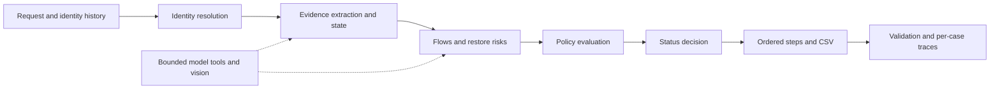

# Northstar Shop Deletion Audit Agent


## Contest result

| Rank | Chat transcript /10 | AI judge interview /30 | Output CSV /30 | Code ZIP /30 | Total /100 |
|---:|---:|---:|---:|---:|---:|
| 411 | 9.2 | 13.8 | 24.9 | 21.6 | **69.5** |

Results above are transcribed from the participant-provided leaderboard screenshot. The screenshot does not identify artifact hashes; historical local evaluation metrics are documented separately.

## What this project does

An evidence-based deletion audit for the fictional Northstar Shop. A successful workflow message does not establish that customer data is gone: copies can remain in replicas, search indexes, analytics, support attachments, exports and backups.

For each request, the agent resolves current and historical identifiers, inspects evidence at the audit cutoff, applies deletion and retention rules, and generates a decision with ordered findings, remediation and verification steps. It produces an audit plan; it does not execute deletion against live systems.

## Architecture



- **Identity:** current and historical emails, user IDs, hashes and phones.
- **Evidence:** JSON, SQL snapshots, logs, text, PDFs and screenshots; explicit resource ownership and timestamps.
- **State and risk:** record treatment, replica drift, active data flows and restore paths.
- **Policy:** DELETE, REDACT, ANONYMIZE and RETAIN, including account tombstones and conditional retention.
- **Model supervision:** bounded `gpt-4o-mini` semantic decisions, strict-schema vision and read-only tool planning; deterministic checks constrain accepted identifiers and decisions.
- **Output:** `COMPLETE`, `INCOMPLETE` or `NOT_APPLICABLE`, with ordered JSON steps and evidence citations.

The pipeline enumerates all 94 manifest entries per case. It reads local evidence snapshots, not live Northstar databases. Extraction and model caches avoid repeated work; their keys account for source content and relevant extraction context. See [design decisions](tradeoff.md) and [coverage reports](code/evaluation/README.md).

## Repository guide

| Path | Contents |
|---|---|
| `code/agent/` | Identity, evidence, state, flows, policy, status, steps and model adapters |
| `code/orchestrator/` | Batch runner, diagnostics, comparisons, validators and packaging |
| `code/tests/` | Unit, integration, regression and synthetic-fixture tests |
| `dataset/` | Original participant-facing requests, policies, activity and evidence |
| `code/evaluation/` | [Indexed evaluation and validation reports](code/evaluation/README.md) |
| `artifacts/csv/` | Historical outputs, comparisons and row-review ledgers |
| `artifacts/submissions/` | Historical source package snapshots |
| `docs/` | [Documentation index](docs/README.md), result image and historical notes |
| `output.csv` | Current 518-row prediction artifact |
| `code.zip`, `artifacts/submissions/agent-trace-public.zip` | Existing source snapshot and redacted public trace |
| `log.txt`, `worklog.md` | Development transcript and task summaries |
| `plan.md`, `tradeoff.md` | Implementation plan and design reasoning |

Source, data and submission entry-point paths are stable so existing commands and reports continue to work. Local environments, API keys, caches, scratch tests and separate interview-analysis copies are excluded from Git.

## Setup

Requires Python 3.10+.

```powershell
python -m venv .venv
.\.venv\Scripts\pip.exe install -r requirements.txt
Copy-Item .env.example .env
```

Set your own `OPENAI_API_KEY` in `.env` to enable model/vision calls. The application reads the repository-local `.env` as its credential source. Never commit it. Model settings use `OPENAI_MODEL` (default `gpt-4o-mini`), `OPENAI_TIMEOUT` (30 seconds) and `OPENAI_MAX_RETRIES` (3). RapidOCR provides local image text corroboration.

## Run

From the repository root on Windows:

```powershell
$env:PYTHONPATH='code'
.\.venv\Scripts\python.exe -m orchestrator.run dataset/deletion_requests.csv output.csv
```

On macOS/Linux after creating and activating a virtual environment and installing requirements:

```bash
PYTHONPATH=code python -m orchestrator.run dataset/deletion_requests.csv output.csv
```

The output columns are exactly `case_id,deletion_status,steps_json`. Each JSON step contains its number, phase, system, resource, operation, state and evidence ID. Findings precede remediation, which precedes verification; flow and restore controls precede dependent record changes.

## Test and validate

```powershell
$env:PYTHONPATH='code'
$env:OPENAI_LLM_DISABLED='1'  # Offline tests; no API calls
.\.venv\Scripts\pytest.exe code/tests -q
.\.venv\Scripts\python.exe -c "from orchestrator.validator import validate_output; print(validate_output('output.csv','dataset/deletion_requests.csv').errors)"
.\.venv\Scripts\python.exe -m orchestrator.step_diff
```

Remove `OPENAI_LLM_DISABLED` before a model-enabled run. `ORCHESTRATOR_SKIP_EVIDENCE=1` is diagnostic only; it cannot establish submission correctness.

The last documented source-review run recorded **502 passing tests and one failing exact-step release gate**. Its public development sample matched **32/32 statuses and 12/32 exact step arrays**. These are local development metrics, distinct from the leaderboard result above. The sample has been used repeatedly during development and is not a held-out benchmark.

## Results, limitations and reproducibility

- Root output: 518 cases, 2,894 steps; 134 COMPLETE, 374 INCOMPLETE, 10 NOT_APPLICABLE.
- The documented structural audit passed 19,440 checks. Structural validity does not establish correctness of every decision.
- The [row review](code/evaluation/score_iteration_validation.md) records 32 rows with evidence limitations, including later-captured observations, workflow-only absence claims and owner-link ambiguity.
- The existing exact-array accuracy gate remains unmet. Known gaps and counterexamples remain visible in tests and reports.
- [Evaluation report](code/evaluation/evaluation_report.md), [usage report](code/evaluation/usage_report.md), [changed rows](code/evaluation/changed_rows.md), and [all-row ledger](artifacts/csv/all_518_row_review.csv) provide detailed evidence.
- [Submission manifest](submission_manifest.md) records the existing artifact hashes and snapshot limitations. The trace ZIP is a historical snapshot, not a record of every later change.

## Submission artifacts

The contest deliverables are the root `output.csv`, `code.zip`, development transcript and requested trace, plus the interview. The source package must include `evaluation/evaluation_report.md` and `evaluation/usage_report.md` and exclude datasets, environments, credentials and caches.

```powershell
$env:PYTHONPATH='code'
.\.venv\Scripts\python.exe -m orchestrator.repackage
```

This command creates a new source package and changes its hash. The committed ZIP is preserved as a historical artifact; the checkout contains the current documentation. See [trace instructions](agent_trace_instructions.md) for trace collection and [worklog](worklog.md) for development history.
